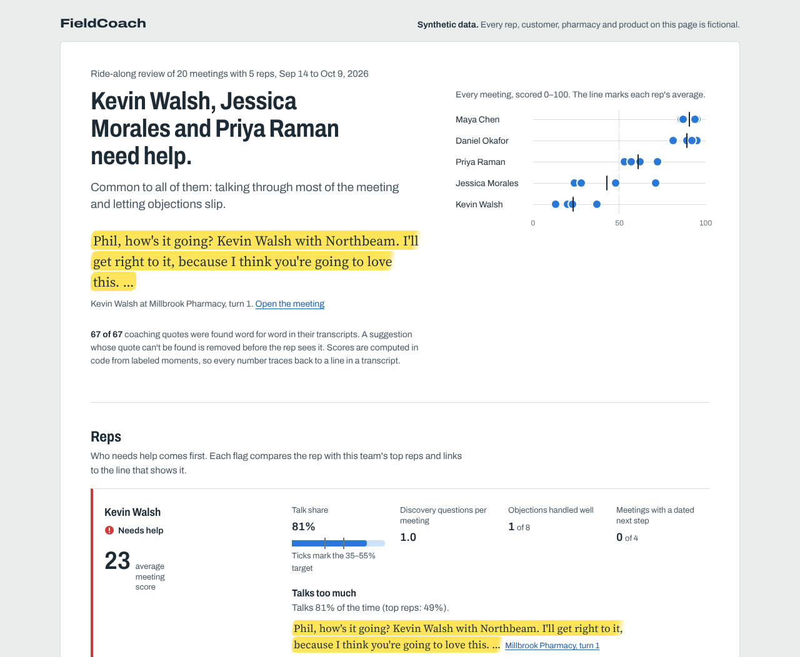
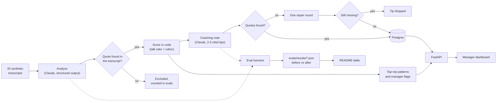

# FieldCoach

FieldCoach is an AI coach for in-person field sales. It reads recorded sales meetings and turns each one into structured data. It then writes the rep a short coaching note in which every point cites a line from the transcript. Managers get one page that shows which reps need help and why.

> **All data in this repo is synthetic.** The 20 meeting transcripts were generated by an LLM for this demo. Every rep, customer, pharmacy, company and product in them (Northbeam Health, RapidPanel, BP-200) is fictional.

## Eval results

<!-- eval-table:start -->
| Check | What it measures | Claude: `claude-sonnet-5-5` | Keyword baseline |
|---|---|---|---|
| Groundedness | Coaching quotes found verbatim in the transcript (first pass → after one repair round) | not run yet | 100% → 100% |
| Groundedness | Analysis quotes found verbatim, in a turn by the right speaker | not run yet | 100% |
| Golden set | Discovery-question F1 (turn level) | not run yet | 0.88 |
| Golden set | Objection F1 (turn level) | not run yet | 0.74 |
| Golden set | Objection handling accuracy (strong / adequate / weak / unaddressed) | not run yet | 59% |
| Golden set | Next-step accuracy (clear / vague / none) | not run yet | 100% |
| Golden set | Meeting score error vs hand labels (MAE, 0–100 scale) | not run yet | 6.3 |
| Consistency | Meeting score SD across 3 runs (mean of 20 transcripts) | not run yet | 0.00 |
| Consistency | Next-step label identical in all 3 runs | not run yet | 100% |

<sub>Baseline: prompts analysis@rules-v1 · coaching@rules-v1 · 20 transcripts × 3 runs · 2026-10-19</sub><br>
<sub>Claude column: set <code>ANTHROPIC_API_KEY</code>, then run <code>make eval</code> and <code>make accept</code> to fill it in.</sub>
<!-- eval-table:end -->

**Groundedness** is the share of quotes that code found word for word in the transcript, in a turn by the right speaker. **Golden set** compares the analysis with hand labels on 10 of the 20 transcripts. **Consistency** reruns every transcript 3 times and measures how much the result moves. The keyword baseline is a set of offline rules. It sets a floor for Claude to beat, and it keeps the demo working without an API key.



<sub>Screenshot of the dashboard built from the offline baseline run.</sub>

## How it works



1. **Transcripts in.** There are 20 condensed pharmacy visits in `data/transcripts/`: 5 reps, 4 meetings each. Two reps are strong, one is mixed and two struggle. One of the two improves in her last meeting. Each file is plain text with a header that says `synthetic: true`. The loader refuses any file without that line.
2. **Analysis.** Claude returns a `MeetingAnalysis` (Pydantic): discovery questions, objections with a category and a handling label, and next-step quality. Every item quotes the transcript. Talk ratio isn't asked of the model. Code counts the words.
3. **Coaching note.** Claude writes 2-3 suggestions plus one thing to keep doing, each with a verbatim quote and turn number. Code checks every quote. If one fails, Claude gets one repair round with the exact failures. A tip that still can't be found is removed before the rep sees it.
4. **Top-rep patterns.** The best 40% of reps by average score are compared with everyone else on discovery questions, question depth, talk share, objection handling and dated next steps. The comparison includes example lines from both groups.
5. **Manager view.** One page shows a status for each rep, flags that compare them with the top reps, a quote behind each flag, and every meeting with its coaching note next to the transcript.

## The eval harness

| Check | How it works |
|---|---|
| Groundedness | Every quote in every analysis and coaching note is looked up in the transcript. Matching ignores case, punctuation and curly apostrophes. The words still have to appear in order, inside one turn, from the right speaker. Paraphrases, merged turns and `...` splices fail. The pass rate is reported before and after the repair round. |
| Golden set | `evals/golden.json` labels 10 transcripts, 2 per rep, at the turn level: which rep turns hold discovery questions, which customer turns raise objections (with category and handling), and the next-step label. Analyses are scored with precision, recall and F1, plus label accuracy. A hallucinated quote counts as a false positive. The meeting score is also compared with the score the hand labels would give (MAE). |
| Consistency | Each transcript is analyzed 3 times. The report shows the mean standard deviation of the 0-100 score, the share of transcripts whose next-step label never changes, and the spread in question and objection counts. |
| Regression | One command reruns everything and prints before vs after against the accepted baseline. Accepting a run updates the table at the top of this README and the data behind the dashboard. |

The loop after a prompt change looks like this:

```bash
# edit fieldcoach/prompts/analysis.md or coaching.md, then
make eval     # rerun pipeline + evals, print before/after (exit 2 on regressions with --fail-on-regression)
make accept   # promote the run, rewrite the README table, refresh the dashboard data
```

Here is what `make eval` prints. This is a real run of the baseline against itself, so nothing changes. A prompt edit shows the deltas, marked `better` or `WORSE`.

```text
Before: heuristic analysis@rules-v1 coaching@rules-v1
After:  heuristic analysis@rules-v1 coaching@rules-v1

Metric                                   Before  After  Change
---------------------------------------  ------  -----  ------
Coaching quotes grounded (after repair)  100%    100%   same
Discovery question F1                    0.88    0.88   same
Objection handling accuracy              59%     59%    same
Meeting score MAE (0-100)                6.3     6.3    same
Score SD across runs                     0.00    0.00   same
...
```

Prompt versions are content hashes, so any edit changes the version. Claude responses are cached under a key built from the model, prompt, input and sample number. An unchanged rerun therefore costs nothing, and an edited prompt always gets fresh answers.

## Run it

**With Docker** (app + Postgres, dashboard at http://localhost:8000):

```bash
cp .env.example .env        # optional: add ANTHROPIC_API_KEY
docker compose up --build
```

On its first request, the app creates its tables and loads the transcripts and the accepted runs into Postgres.

**Locally** (Python 3.11+):

```bash
pip install -e ".[dev]"
pytest                      # no API key or database needed
fieldcoach serve            # dashboard from the tracked files, no database needed
```

**With Claude** (fills in the Claude column above):

```bash
export ANTHROPIC_API_KEY=...          # or put it in .env
fieldcoach eval                       # 60 analysis calls (20 transcripts x 3) + 20 coaching notes
fieldcoach accept
fieldcoach analyze T13                # one meeting, printed as a readable report
```

The default model is `claude-sonnet-5-5`. Set `FIELDCOACH_MODEL` to compare another model, for example `claude-haiku-5-5`, on the same evals. `FIELDCOACH_EFFORT=low|medium|high` trades depth for speed. `FIELDCOACH_CONCURRENCY` (default 4) sets how many requests run in parallel. If `DATABASE_URL` is set, every eval run is also recorded in Postgres.

## Design decisions

- **Count in code, judge with the model.** Talk ratio, the 0-100 score and every roll-up are computed in Python. The model only labels moments: this is a discovery question, this objection was handled weakly. Each number on the dashboard traces back to labels, and each label traces back to a quote.
- **Evidence or it didn't happen.** Analysis items with an ungrounded quote are left out of scoring and counted against precision. Only grounded items are passed on to the coaching prompt. A coaching tip whose quote fails twice never reaches the rep.
- **Structured outputs, not tool calls.** Requests use `output_config.format` with a JSON schema built from the Pydantic models (`anthropic.transform_schema`). The response is validated by Pydantic, with one retry on invalid JSON. No sampling parameters are sent, because current models only accept their defaults. The consistency check therefore measures real run-to-run variation.
- **The rubric is shared.** `fieldcoach/prompts/analysis.md` is the labeling guide for both Claude and the golden set, so both are judged by the same definitions.
- **A baseline to beat.** The keyword rules (`HeuristicBackend`) run through the same pipeline and evals. If Claude doesn't clearly beat them on a metric, that metric needs work.
- **Postgres with raw SQL and JSONB.** There are three tables: `transcripts`, `runs` and `meeting_results`. The documents are stored as JSONB, with a few columns pulled out for joins and aggregates. See `fieldcoach/store.py`.

## API

| Endpoint | Returns |
|---|---|
| `GET /` | The manager dashboard |
| `GET /api/reps` | Rep summaries with status, flags and evidence |
| `GET /api/patterns` | Top reps vs everyone else |
| `GET /api/meetings`, `GET /api/meetings/{id}` | Meeting list, or one transcript with its analysis and coaching note |
| `GET /api/evals` | The full eval report behind the current run |
| `POST /api/analyze` | Analyze and coach a pasted transcript (same text format; must be marked synthetic). Nothing is stored. Uses the keyword baseline unless `FIELDCOACH_API_BACKEND=claude`, so a public deploy can't spend API credits. |
| `GET /healthz` | Liveness, storage mode and current run id |

## Deploying to Cloud Run

This hasn't been deployed. These are the commands for a deploy that serves the tracked files, so no database is needed:

```bash
gcloud run deploy fieldcoach --source . --region us-central1 --allow-unauthenticated
```

For Postgres, point `DATABASE_URL` at Cloud SQL, for example `postgresql://USER:PASS@/fieldcoach?host=/cloudsql/PROJECT:REGION:INSTANCE`, and add `--add-cloudsql-instances PROJECT:REGION:INSTANCE`. Store the password and `ANTHROPIC_API_KEY` in Secret Manager rather than in plain env vars.

## Project layout

```text
data/transcripts/     20 synthetic transcripts (plain text)
data/runs/            accepted pipeline runs, one per backend (dashboard data)
evals/golden.json     hand labels for 10 transcripts
evals/results/        accepted eval reports, one per backend
fieldcoach/
  prompts/            analysis.md and coaching.md (versioned by content hash)
  schemas.py          Pydantic models
  llm.py              Claude client: structured outputs, retry, cache
  backends.py         Claude backend and the keyword baseline
  grounding.py        quote checks
  pipeline.py         analyze -> ground -> score -> coach -> repair
  scoring.py          rubric score, rep flags, top-rep patterns
  evals.py            groundedness, golden set, consistency, regression table
  store.py            files or Postgres
  api.py              FastAPI app; templates/dashboard.html is the one page
  cli.py              fieldcoach eval | accept | analyze | load | serve | readme
tests/                runs offline; the Claude path is tested through the real SDK against a fake API
```

## Limits

- The data is synthetic, and the transcripts are condensed (about 200 to 1,000 words each, where a real visit runs 10 to 20 minutes). Real recordings would add crosstalk, transcription errors and much longer meetings.
- The golden labels were written by the same author as the transcripts, with no second annotator. With 10 meetings, small changes in the numbers are noise. Treat the table as a regression signal, not a benchmark.
- The keyword baseline was written by someone who had read the transcripts, so it's an optimistic floor.
- The score rubric weights (discovery 30, objections 30, talk 20, next step 20, and a 35-55% talk band) are a starting point. In a real deployment they would be fitted to outcomes such as orders placed.
